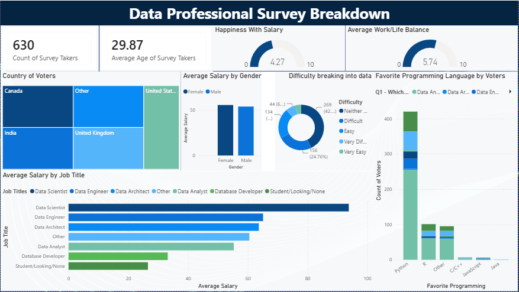

# Data Professional Survey Analysis (Power BI)

What does the data profession look like? Who is in it, what do they earn, how happy are they, and how hard was it to break in?

This project analyzes survey responses from 630 data professionals and presents the results in an interactive Power BI dashboard.

## Dashboard

*Full interactive version: download the `.pbix` file and open it in [Power BI Desktop](https://powerbi.microsoft.com/desktop/) (free). Filters and cross-highlighting between visuals are fully functional.*

## Questions Explored
- Where do survey respondents live, and how old are they?
- How much do different data roles earn, and does pay differ by gender?
- How happy are data professionals with their salary and work/life balance?
- How difficult was it to break into data?
- Which programming languages do data professionals prefer?

## Data
Data Professional Survey responses (630 respondents): job title, salary range, industry, favorite programming language, happiness ratings, difficulty of breaking into data, gender, age and country.

## Process

1. **Loaded the survey data** into Power BI with Power Query
2. **Removed personal and unneeded columns**: email, browser, operating system, city and referrer
3. **Cleaned text columns**: split job title, favorite programming language, country and industry on their delimiters to keep only the main label
4. **Converted salary ranges into a number**: salary was collected as text ranges (e.g. `$40-50k`), so I split each range into a lower and upper value and averaged them into an `Average Salary` column (top bracket `225k+` capped at 225)
5. **Set data types** for dates, times and happiness ratings
6. **Built the dashboard**: KPI cards, gauges, a treemap, bar charts, a donut chart and a stacked column chart, with cross-filtering between visuals

## Key Findings

- **630 respondents**, with an average age of about **30**
- **Data Scientists earn the most**, with an average salary of roughly $93K, well ahead of Data Engineers (~$65K) and Data Architects (~$64K)
- **Data Analysts average about $55K**, while Database Developers (~$33K) and Students/Job Seekers (~$27K) sit at the bottom
- **No meaningful gender pay gap in this sample**: average salary for women and men is nearly identical (~$55-57K)
- **Respondents are not happy with their pay**: average happiness with salary is only **4.27/10**, while work/life balance scores higher at **5.74/10**
- **Breaking into data is not seen as easy**: about 43% rated it neither easy nor difficult and about 25% found it difficult
- **Python dominates**: roughly two thirds of respondents picked it as their favorite language, far ahead of R

## Files
- [`Data_survey_analysis.pbix`](Data_survey_analysis.pbix): Power BI report

## Skills Demonstrated
Power Query data cleaning · Data transformation · KPI cards and gauges · Interactive dashboard design · Cross-filtering · Data storytelling

## Tools
Power BI · Power Query

---
Data via Alex the Analyst.
